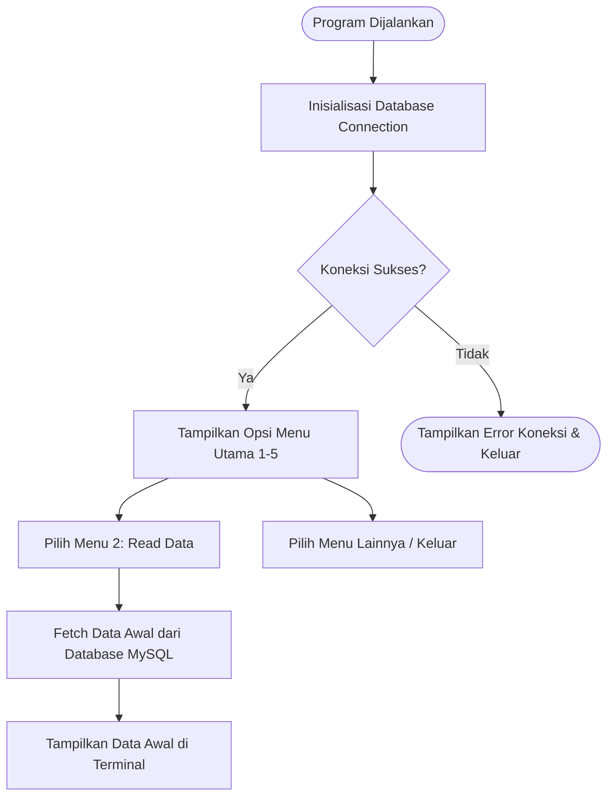

# Mini Project 4 PBO - Aplikasi Pengelolaan Rental Console PS (JDBC & ORM)

Program **Sistem Pengelolaan Rental PlayStation (PS)** berbasis Java CLI yang dikembangkan untuk memenuhi **Mini Project 4 – Pemrograman Berorientasi Objek (PBO)**. Proyek ini menyempurnakan penyimpanan data dari memori sementara (`ArrayList`) menjadi basis data relasional (**MySQL Database**) menggunakan **JDBC PreparedStatement**, **Data Access Object (DAO)**, serta **Framework ORM**.

- **Nama:** Muhammad Yusri Jibran Sugiharta Jusuf
- **NIM:** (2509116030
- **Kelas Praktikum:** Pemrograman Berorientasi Objek (PBO)

---

## 1. Deskripsi Singkat Program

**Sistem Pengelolaan Rental PS** adalah aplikasi berbasis CLI untuk mengelola unit PlayStation dan transaksi penyewaan secara tersentralisasi pada database MySQL (`db_rental_ps`). Fitur utama berbasis **CRUD**:

| Opsi Menu | Nama Fitur | Fungsi & Deskripsi |
|-----------|------------|--------------------|
| 1 | Tambah Unit PS | **Create** - Menambahkan data ke database via JDBC / ORM |
| 2 | Daftar Unit PS | **Read** - Menampilkan seluruh data unit terdaftar dari database |
| 3 | Hapus Unit PS | **Delete** - Menghapus baris data unit dari database berdasarkan ID |
| 4 | Transaksi Rental | **Transaction** - Memproses penyewaan unit & kalkulasi diskon |
| 5 | Keluar Aplikasi | Menutup koneksi database dan mengakhiri program |

---

## 2. Penjelasan Struktur Package

```text
Minpro-4-PBO-ManajemenRentalPS/
├── database.sql
└── src/
    ├── config/
    │   └── DatabaseConfig.java
    ├── model/
    │   ├── Console.java
    │   ├── PSReguler.java
    │   ├── PSVIP.java
    │   ├── Pelanggan.java
    │   └── Rental.java
    ├── dao/
    │   ├── ConsoleDAO.java
    │   └── impl/
    │       └── ConsoleDAOImpl.java
    ├── repository/
    │   └── ConsoleORMRepository.java
    ├── controller/
    │   ├── Diskonable.java
    │   ├── PSController.java
    │   └── RentalController.java
    ├── view/
    │   └── MainView.java
    └── main/
        └── Main.java

| Nama Package | Peran dan Tugas Utama |
| --- | --- |
| config | Mengatur koneksi basis data MySQL via DriverManager. |
| model | Struktur data entitas (Console, PSReguler, PSVIP, Pelanggan, Rental). |
| dao | Layer akses data menggunakan JDBC PreparedStatement. |
| repository | Layer pemetaan objek berbasis Framework ORM. |
| controller | Pengatur alur logika bisnis dan interaksi database. |
| view | Antarmuka pengguna CLI. |
```

## 3. Penjelasan Alur Program
### 3.1 Flowchart Diagram



### 3.2 Penjelasan Alur Operasi
Inisialisasi Database: Saat program pertama kali dijalankan, aplikasi terhubung ke database db_rental_ps melalui kelas DatabaseConfig.

Membaca Data Awal (Read): Data awal tidak di-insert lewat kode Java, melainkan sudah di-import terlebih dahulu via file database.sql di MySQL. Saat pengguna memilih Menu 2 (Read), program mengeksekusi query SELECT * FROM console untuk mengambil dan menampilkan data awal tersebut ke terminal.

Penyimpanan Data Baru (Create): Penambahan data baru melalui program akan disimpan secara permanen ke tabel console menggunakan PreparedStatement atau ORM.

## 4. Penjelasan Penerapan Encapsulation dan Inheritance
### 4.1 Encapsulation
Atribut pada entitas model dikunci dengan variabel private. Akses data diatur ketat via method getter dan setter. Atribut identitas seperti id menggunakan keyword final (immutable).

### 4.2 Inheritance
Struktur pewarisan kelas terbagi dari 1 superclass ke 2 subclass:

┌──────────────────────────────┐
                  │   Console (Abstract Class)   │
                  │ - id (final)                 │
                  │ - jenis                      │
                  │ - hargaPerJam                │
                  └──────────────┬───────────────┘
                                 │
                 ┌───────────────┴───────────────┐
                 │                               │
┌────────────────┴───────────────┐ ┌─────────────┴────────────────┐
│           PSReguler            │ │             PSVIP              │
│ + jumlahStik (final)           │ │ + fasilitasVIP (final)         │
└────────────────────────────────┘ └────────────────────────────────┘

## 5. Penjelasan Abstraction dan Polymorphism
### 5.1 Abstraction
Class Console bertindak sebagai abstract class dengan metode abstrak public abstract void displayInfo();.

### 5.2 Polymorphism
Method Overriding: Implementation displayInfo() berbeda antara PSReguler dan PSVIP.

Method Overloading: Metode hitungTotal() pada RentalController memiliki 2 signature (kalkulasi harga normal & kalkulasi harga diskon).

## 6. Penjelasan Penerapan JDBC
Pengelolaan basis data dilakukan menggunakan Java Database Connectivity (JDBC) dengan mekanisme:

DriverManager.getConnection(): Membuka jalur komunikasi aktif ke database MySQL.

PreparedStatement: Menjalankan query terparameterisasi (INSERT, SELECT, DELETE) guna mencegah SQL Injection.

ResultSet: Menampung baris data hasil query untuk dikonversi kembali ke dalam bentuk instance objek Java.

## 7. Penjelasan Letak Penerapan Nilai Tambah (ORM Framework)
Nilai tambah diimplementasikan pada package repository/ConsoleORMRepository.java:

Object-Relational Mapping (ORM): Mengotomatisasi pemetaan entitas objek Java secara langsung ke atribut kolom tabel database menggunakan teknik Object Reflection.

Pemetaan tipe entitas secara dinamis mengubah instance objek Console menjadi baris data relasional tanpa perlu menuliskan query SQL secara manual.


